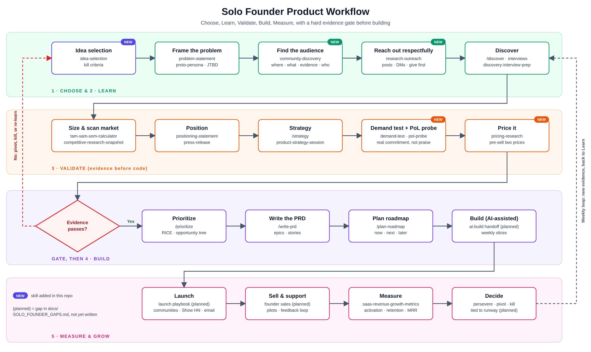

# Product Management Skills

PM skills and slash commands for Claude Code, plus a repeatable workflow for a solo founder building a product from scratch.

*Vector version: [`docs/workflow.svg`](docs/workflow.svg). Step-by-step guide: [`docs/FOUNDER_WORKFLOW.md`](docs/FOUNDER_WORKFLOW.md). Known gaps: [`docs/SOLO_FOUNDER_GAPS.md`](docs/SOLO_FOUNDER_GAPS.md).*

## What is here
- `.claude/skills/`: PM skills. 77 from upstream plus 5 original ones for solo founders:
  `idea-selection`, `community-discovery`, `research-outreach`, `demand-test`, `pricing-research`.
- `.claude/commands/`: `/discover`, `/strategy`, `/prioritize`, `/write-prd`, `/plan-roadmap`, `/leadership-transition`.
- `ventures/trustreply/`: a worked example that applies the workflow to a sample idea. Desk research only; no interviews have been run and figures are unverified.

## How Claude Code uses it
Claude Code loads `.claude/skills/` and `.claude/commands/` automatically. Name a skill, type a command,
or describe the task and the matching skill loads. `CLAUDE.md` points sessions at the founder workflow.

## Attribution and license
Upstream skills and commands are copied from https://github.com/deanpeters/product-manager-skills
(commit cfcb697) by Dean Peters, licensed CC BY-NC-SA 4.0 (see `LICENSE`). Non-commercial use only;
derivatives must use the same license. The five original skills are listed in `.claude/skills/PM-SKILLS-NOTICE.md`.
