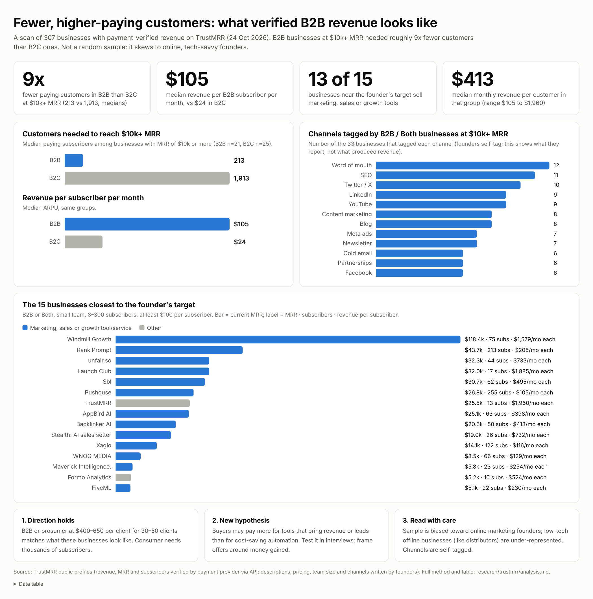

# TrustMRR scan: what B2B and B2C businesses with verified revenue look like
Date: 2026-10-24. Purpose: check the B2B vs B2C decision (`docs/B2B_VS_B2C.md`) against real, payment-verified businesses.

*Source file: `insights.html` (open in a browser; hover bars for values).*

## Method
- Source: public TrustMRR pages read with `curl` (scripts in this folder: `crawl.py`, `parse.py`). TrustMRR says revenue, MRR and subscriber counts come from the startup's payment provider via API key; descriptions, pricing text, team size and channel tags are founder-written.
- Sample: 307 startups found on the first page (30 each) of 25 marketing-channel pages, then each startup's markdown profile. This is **not a random sample**: it is biased toward founders who list on TrustMRR (online, tech-savvy, many for sale) and toward businesses that tagged a channel. Low-tech offline-facing B2B (like distributors) is probably under-represented.
- MRR on TrustMRR can differ from last-30-day revenue; a few listings show much larger 30-day revenue than MRR (one-off or non-recurring payments), so I used MRR and subscriptions for ARPU.

## B2B vs B2C in this sample
| Group | Businesses | Median MRR (all) | Median subs (all) | Median ARPU (all) |
|---|---|---|---|---|
| B2B | 114 | $1.1k | 10.5 | $60 |
| Both | 58 | $1.2k | 40 | $25 |
| B2C | 89 | $0.8k | 17 | $18 |

Among businesses with MRR of at least $10k (70 in the sample; audience: B2C 25, B2B 21, Both 12, unlisted 12):
| Group | Median paying subscribers | Median ARPU |
|---|---|---|
| B2B (21) | 213 | about $105/mo |
| B2C (25) | 1,913 | about $24/mo |

So reaching $10k+ takes roughly **9x fewer customers in B2B**. This matches the arithmetic in `docs/B2B_VS_B2C.md`. White Glove Content ($119 ARPU, 548 subs) sits in between.

## Businesses closest to the founder's target
Filter: B2B or Both, team of 1, 2-5 or not stated, MRR $5k-$120k, 8-300 subscribers, ARPU at least $100. 15 matches.

| Business | Audience | Team | MRR | Subs | ARPU | Founded | What it does | Pricing (as written) | Channels (self-tagged) |
|---|---|---|---|---|---|---|---|---|---|
| Windmill Growth, LLC | B2B | ? | $118,447 | 75 | $1,579 | 2024-05-15 | Windmill provides marketing services to help amplify personal brands. | $3,999/month | linkedin, twitter |
| Rank Prompt | B2B | ? | $43,721 | 213 | $205 | 2025-05-15 | Rank Prompt helps users understand how their website shows up on AI Search Engines and how to improve it. AEO  | Free first report · No credit card required. Paid plans include Starte | newsletter, content-marketing, blog |
| unfair.so | B2B | 2–5 people | $32,273 | 44 | $733 | 2026-07-12 | Helping companies to find, engage and outreach to potential users. | Unfair — $79/month Very Unfair — $249/month Unfairmaxxing — $799/month | cold-email, cold-dm, partnerships, seo |
| Launch Club | B2B | ? | $32,050 | 17 | $1,885 | 2022-12-07 | Reddit marketing to improve AI search. SaaS helping business owners learn how to promote their products. Also  | n/a | cold-email, cold-dm, referral-program, meta-ads |
| Sbl | Both | 2–5 people | $30,698 | 62 | $495 | 2023-07-13 | Sbl.so is an AI SDR platform for B2B teams to discover prospects showing real buying intent, reach them across | Starter $99/mo, Pro $189/mo, Elite $997/mo . | linkedin, twitter, youtube, newsletter |
| Pushouse | B2B | ? | $26,750 | 255 | $105 | 2026-01-16 | Pushouse provides software and technology services that enable e-commerce businesses to automate customer comm | n/a | cold-email, linkedin, partnerships, meta-ads |
| TrustMRR | B2B | 1 person | $25,483 | 13 | $1,960 | 2025-10-31 | The $1.2B database of verified startup revenues. Accidentally a startup marketplace. | n/a | linkedin, reddit, seo, word-of-mouth |
| AppBird AI | Both | 2–5 people | $25,091 | 63 | $398 | 2026-03-01 | AppBird is an AI-powered market intelligence platform for apps and games. Discover new releases, uncover hidde | Pro: $199/month. Elite: $399/month. Custom team and enterprise plans a | linkedin |
| Backlinker AI | B2B | ? | $20,650 | 50 | $413 | 2023-07-06 | Backlinker AI automates backlink acquisition through AI-powered reporter and editorial outreach. Built for age | $300/ month | cold-email, cold-dm, partnerships, seo |
| Stealth (name hidden) | B2B | 2–5 people | $19,033 | 26 | $732 | 2025-05-19 | An AI sales setter for Instagram DMs and WhatsApp. It answers every prospect in the founder's own voice 24/7,  | Fixed monthly subscription, no commitment, no per-message fees. Plans  | cold-dm, linkedin, partnerships, word-of-mouth |
| Xagio Inc | B2B | ? | $14,106 | 122 | $116 | 2025-05-13 | Online Marketing Services | Free: $0/mo | facebook |
| WNOG MEDIA | Both | ? | $8,494 | 66 | $129 | 2018-04-15 | Hire your own Instagram Growth Manager. WNOG MEDIA gives athletes, entrepreneurs, creators and businesses a de | $140/month (Standard), $190/month (Premium, regularly $269). Month to  | partnerships, referral-program |
| Maverick Intelligence, Inc. | B2B | ? | $5,834 | 23 | $254 | 2025-12-10 | • Maverick Intelligence identifies who visit your website. • Maverick Intelligence identifies exactly where th | $250/month - low $2,300/month - high You can charge more if you want.  | cold-email, cold-dm |
| Formo Analytics | B2B | 1 person | $5,240 | 10 | $524 | 2024-09-30 | Analytics and attribution for DeFi apps. Measure what matters and drive growth onchain with the data platform  | $249/month (Growth), $499/month (Scale) | cold-email, cold-dm, reddit |
| FiveML LTD | B2B | 1 person | $5,062 | 22 | $230 | 2025-04-07 | FiveML LTD provides LVI, a LinkedIn automation platform that helps businesses generate leads by automating pro | $149.99 per user / month with discounts for additional users and prepa | cold-email, linkedin |

## Patterns (observations, not proof)
1. **13 of the 15 sell marketing, sales or growth tools or services** (lead generation, outreach, SEO/AI-search, social growth, website-visitor identification). Revenue per customer in this group runs from $105 to $1,960 a month (median $413); customers pay for something that brings them customers. I found no cost-saving back-office tools in this cohort, but the sample is biased toward online-marketing founders.
2. **Pricing ladders are common**: three tiers such as $79/$249/$799 or $99/$189/$997; month-to-month.
3. **Channels:** across B2B/Both businesses with $10k+ MRR the most-tagged channels were word of mouth (12), SEO (11), Twitter/X (10), LinkedIn (9), YouTube (9), content marketing and blog (8 each), meta ads and newsletter (7 each), cold email and partnerships (6 each). In the 15-business cohort, LinkedIn, cold DM, partnerships and Twitter/X recur. This is self-tagged and shows what founders report, not what produced the revenue.
4. **High-ACV services exist at small scale:** one business sells marketing services at $3,999 a month to 75 clients (about $118k MRR). It is labor-heavy and its team size is not stated.
5. **Speed:** unfair.so (outreach tool, 2-5 people) shows about $32k MRR with 44 subscribers about 3 months after its listed founding date; AppBird AI shows about $25k MRR with 63 subscribers about 7-8 months in. Single cases; check before treating as typical.
6. **Margins** where stated: 65-91% for most; one at 30%, one at 35%.

## What this means for the founder
- It supports the earlier conclusion: for 30-50 clients at $400-650, B2B (or prosumer) tools at a median of about $413 ARPU are common; consumer needs thousands of subscribers.
- **New hypothesis to test:** customers pay more readily for tools that bring revenue or leads than for cost-saving automation. This does not mean the distributor idea fails; it means the pitch should be framed around money gained (faster quoting, more orders handled, fewer lost orders), and the interview must test it. 🔵
- The people on TrustMRR are mostly in the online-marketing ecosystem, so this is weak evidence about low-tech owner-operated businesses.
- Next checks: read the 3-4 closest businesses' public marketing (pricing pages, how they find customers); search whether any listed business sells back-office tools to non-tech owners; then continue the two-week `demand-test` plan.
